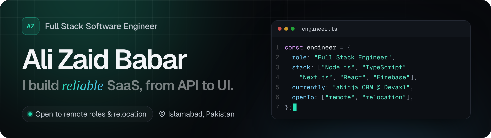
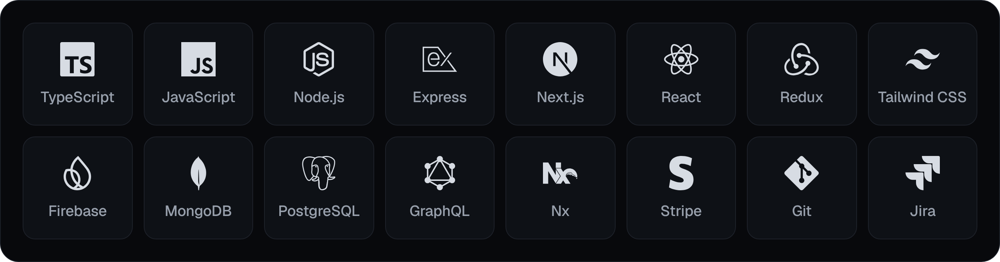

<a href="https://alizaidbabarportfolio.vercel.app/">
  <picture>
    <source media="(prefers-color-scheme: dark)" srcset="./assets/banner-dark.png">
    <source media="(prefers-color-scheme: light)" srcset="./assets/banner-light.png">
    
  </picture>
</a>

  &nbsp;
  &nbsp;
  &nbsp;
  

 

### About

I'm a **Full Stack Software Engineer** with **2+ years** of professional experience building production **B2B SaaS** on **Node.js, TypeScript, Next.js, React and Firebase**.

At **Devaxl** I engineer **[aNinja](https://www.aninja.com/)**, a CRM and business-automation platform for a US-based client, and work directly with the client's team in daily huddles across time zones. My focus is the backend: RESTful APIs, Cloud Functions, third-party integrations and reliable, high-volume data processing. I use AI coding assistants to ship faster, and I review and validate everything they generate.

- **Now:** Software Engineer at Devaxl, building aNinja CRM
- **Based in:** Islamabad, Pakistan (PKT, UTC+5), working daily with a US team
- **Open to:** remote roles and relocation

### Selected impact

| Area | What I delivered |
| :-- | :-- |
| **Data at scale** | Rebuilt the bulk lead-import pipeline with **Node.js streams**, replacing fragile loop-and-batch processing so imports of **100K+ records** run reliably. |
| **Security & multi-tenancy** | Secured the import endpoint with authentication and input validation, and fixed a **tenant-isolation bug** that was importing one account's leads into another. |
| **Integrations** | Wired **Stripe, Twilio, Nylas, Algolia, Meta and WordPress** into core CRM workflows: billing, messaging, email sync, search, marketing and lead ingestion. |
| **Real-time product** | Built **Firestore ↔ Redux** state sync and centralized trial and subscription logic that drives feature gating across the product. |
| **AI features** | Shipped an in-app chatbot and intelligent user onboarding flows. |

### Tech stack

<picture>
  <source media="(prefers-color-scheme: dark)" srcset="./assets/stack-dark.png">
  <source media="(prefers-color-scheme: light)" srcset="./assets/stack-light.png">
  
</picture>

<b>Full toolkit</b>

 

| Domain | Tools |
| :-- | :-- |
| **Languages** | TypeScript, JavaScript, SQL, HTML, CSS |
| **Backend** | Node.js, Express.js, RESTful APIs, GraphQL, Firebase Cloud Functions, Node.js Streams |
| **Frontend** | React, Next.js, Redux, Tailwind CSS, responsive UI |
| **Databases** | MongoDB, Firestore, PostgreSQL, MySQL |
| **Cloud** | Firebase (Authentication, Firestore, Cloud Functions), AWS (working knowledge) |
| **Architecture** | Nx monorepo, REST API design, real-time data sync, authentication, RBAC, multi-tenant isolation, feature gating |
| **Integrations** | Stripe, Twilio, Nylas, Algolia, Meta, WordPress, Zapier |
| **Workflow** | Git, GitHub, Jira, Agile / Scrum, code review, debugging |
| **AI-assisted** | Cursor, Claude, Antigravity, OpenAI API |

### Experience

| Role | Company | Period |
| :-- | :-- | :-- |
| **Software Engineer** | Devaxl · aNinja CRM for a US-based client | Jan 2025 – Present |
| **Associate Software Engineer** | ENCS · MERN web applications | Jul 2024 – Dec 2024 |
| **Web Developer Intern** | TECRUX Global | Jun 2022 – Sep 2022 |

- **Education:** BS Computer Science, Sir Syed CASE Institute of Technology (2020 – 2024)
- **Certification:** Certified Web Engineer, Hazza Institute (2022)
- **Languages:** English (fluent), Urdu (native)

### Featured work

**[aNinja CRM](https://www.aninja.com/)** · Production B2B SaaS  
CRM for lead management, marketing automation and business communication. Streamed 100K+ lead imports, multi-tenant isolation, role-based access control, Calendly-style booking and AI-powered onboarding.  
`Next.js` `Node.js` `TypeScript` `Firebase` `Redux` `Nx`

**Password Manager** · Web app and Chrome extension  
LastPass-inspired vault with AES-256 encryption, role-based access, multi-factor authentication (Google, Microsoft, Duo, Email), autofill, a password generator, Emergency Access and dark-web monitoring via Enzoic.  
`React` `Tailwind CSS` `Node.js` `Express` `MongoDB` `JWT`

### Get in touch

I'm open to remote roles and relocation. The fastest way to reach me is **[alizaidbaber@gmail.com](mailto:alizaidbaber@gmail.com)**. You can also find me on **[LinkedIn](https://www.linkedin.com/in/alizaidbabar/)** or see more of my work on my **[portfolio](https://alizaidbabarportfolio.vercel.app/)**.
